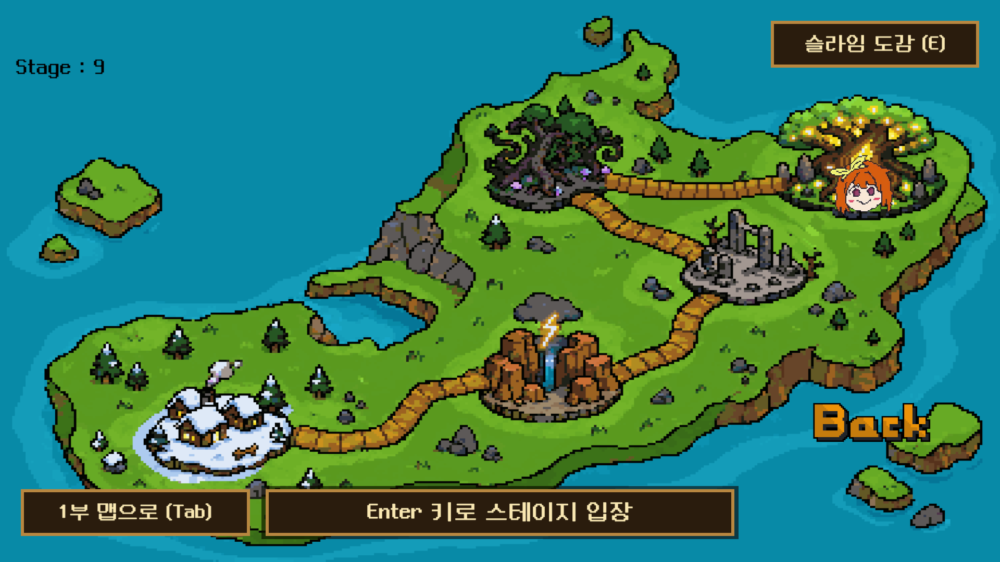
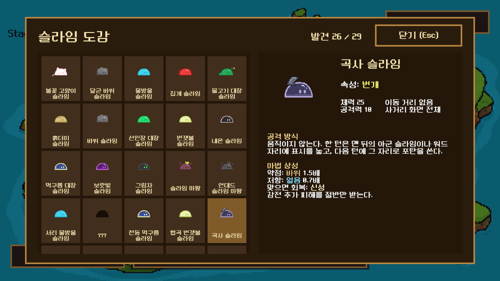
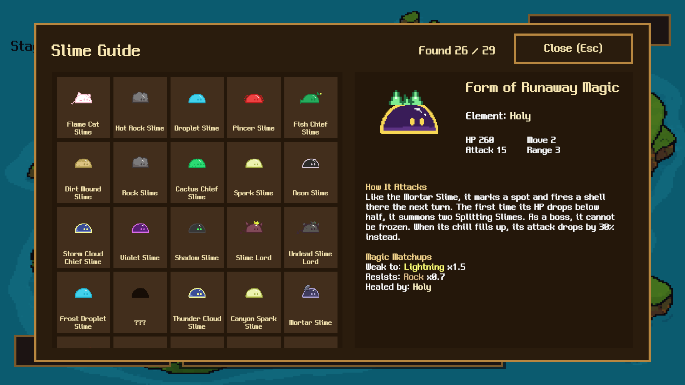

# Issue 99: 맵 화면에 만난 슬라임 도감 추가

- Date: 2026-10-13
- Issue: https://github.com/Apptive-Game-Team/WordVenture/issues/99
- Branch: `feat/slime-encyclopedia` (`origin/develop` 위)

## 변경

- 발견 기록: `EnemyPoolController.SpawnObject` 가 적을 만들 때 `SaveLoadController.MarkSlimeSeen(id)` 를 부른다.
  웨이브 적과 분열 슬라임, 최종 보스가 부른 적이 모두 이 함수를 지난다.
  도감 기록 전의 세이브도 채우도록 `MapMove.Start` 가 `SlimeEncyclopediaView.RecordClearedStages` 를 부른다. 깬 스테이지
  (`stageID < StagePosition`)의 `enemyWaves[0]` 웨이브 적과, 그 적의 `Enemy.SummonedEnemyId`(분열 슬라임의 작은 슬라임,
  최종 보스의 분열 슬라임)를 기록한다. 스테이지 목록은 `TurnBattleScene` 의 `StageManager.stageDataList` 와 같은 10개다. 대화 기록과 같이 PlayerPrefs int 에
  비트로 기록하고, int 하나에 31개씩 `SeenSlimes0`, `SeenSlimes1` 두 key 를 쓴다. 새 게임(`InitPlayData`)에서 지운다.
- 이름: `EnemyData` 에 `displayName` 을 더하고 `EnemyDataContainer.asset` 의 30개 항목 가운데 29개에 이름을 적는다.
  어느 스테이지에도 나오지 않는 `S0_Boss_Slime`(id 2)은 이름을 비워 도감에서 뺀다.
- 공격 방식: `Enemy.AttackDescription` virtual property 를 두고 행동이 다른 클래스마다 설명을 덮어쓴다.
  도감은 prefab 의 `Enemy` component 에서 읽으므로 클래스와 설명이 같은 파일에 있다.
- 속성: `MagicAffinityTable` 에서 불, 얼음, 바위, 번개, 신성 마법이 이 슬라임에게 주는 배율을 읽어
  약점, 저항, 회복으로 나눈다. 속성별 상태 이상 저항은 쓰이지 않던 `ElementalStatus.ResistanceDescription` 을
  문장으로 고쳐 쓴다.
- 화면: `SlimeEncyclopediaView` 가 코드로 Canvas 를 만든다. 왼쪽은 슬라임 목록(ScrollRect, 5열), 오른쪽은 고른 슬라임의
  그림, 이름, 속성, 체력·공격력과 이동 거리·사거리(두 열), 공격 방식, 마법 배율이다. 칸 크기는 목록 너비에 맞춰 5열로 계산한다. 만나지 않은 슬라임은 검은 그림과 `???` 로 보인다.
  `MapMove` 가 오른쪽 위에 `슬라임 도감 (E)` 버튼을 만들고, Esc 나 닫기 버튼으로 닫는다. 열려 있는 동안
  `InteractionLock` 으로 맵 이동을 막는다.
- 번역: 새 한국어 문구를 `Resources/Localization/English.json` 에 더한다. 폰트 atlas 에 ASCII 와 한글만 있으므로
  `·`, `×` 를 쓰지 않는다.

## 검증

- EditMode `SlimeEncyclopediaDataTests`: 웨이브와 소환에 나오는 적은 모두 도감 이름이 있다. 도감에 실린 적마다 영어 이름,
  공격 방식과 그 영어 번역, `SlimeAnimator` 첫 프레임이 있다.
- PlayMode `SlimeEncyclopediaPlayTests`: 기록이 빈 세이브로 `StagePosition` 8 의 맵을 열면 스테이지 0~7 의 적과 작은 분열
  슬라임(25)이 기록되고, 2 와 26~29 는 기록되지 않는다. 적을 소환하면 발견으로 기록되고(id 31 이상은 두 번째 key) `InitPlayData` 가 지운다.
  맵의 버튼으로 연 도감은 만난 슬라임만 이름과 수치를 보여 주고, 닫으면 `InteractionLock` 이 풀린다.
- Unity 2022.3.34f1 batchmode 결과
  - EditMode: 148개 중 145개 통과, 2개 실패, 1개 skip. 실패한 `LocalizationTests` 2개는 2부 대사와 `2부 맵으로 (Tab)` 의 번역이
    없어서 생기며, 이 작업 전 기준선에서도 실패한다.
  - PlayMode: 커밋한 테스트 49개 중 47개 통과, 1개 실패, 1개(`BalanceSimulation`) skip. 실패한
    `ThunderCanyonEnemyPlayTests` 의 곡사 탄 테스트는 탄이 떨어지기를 0.8초 기다리는 타이밍 테스트이고, 이 파일만 두 번 다시
    실행했을 때 두 번 모두 7개 전부 통과했다. 바로 앞 전체 실행에서도 통과했다.
- PlayMode 테스트가 맵이나 전투를 열면 `SeenSlimes0`, `SeenSlimes1` 을 쓰므로, 맵과 전투를 여는 테스트 9개의 PlayerPrefs 복원
  목록에 두 key 를 더했다.
- screen capture: 커밋하지 않는 임시 PlayMode 테스트로 1920x1080 에 찍었다.

## 미리보기

검은 그림과 `???` 칸은 아직 만나지 않은 슬라임이다.

## 남은 위험

- 깬 스테이지 기준 기록은 그 스테이지의 모든 적을 만났다고 본다. 최종 보스가 체력 절반 아래에서 부르는 분열 슬라임도
  보스를 쓰러뜨렸다면 만났으므로 기록한다.
- 불 속성 슬라임은 상성 표에 약점과 저항이 없어서 `약점: 없음`, `저항: 없음` 으로 보인다. 표의 값 그대로다.
